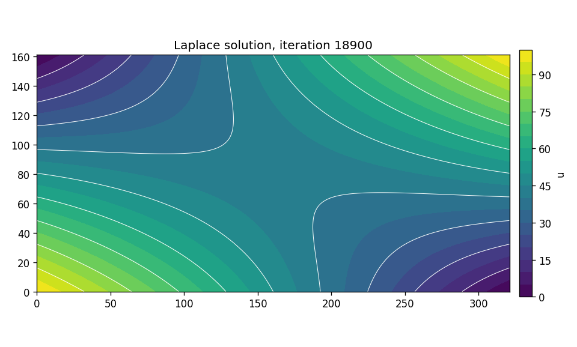

# laplace_cuda

A CUDA solver for **Laplace's equation** ∇²u = 0 on a 2-D grid. It uses Jacobi iteration with shared-memory tiling, checks convergence on the GPU with cuBLAS, and verifies every result against a CPU reference. Laplace's equation describes steady-state heat conduction, electrostatic potential, and incompressible potential flow; this stencil pattern is the core of many CFD and physics codes.



## Performance

RTX 4080 (16 GB) vs. one core of an i7-13700KF. Throughput is grid cells updated per second over 2,000 iterations. The GPU result matches the CPU reference **bit for bit** (max |GPU − CPU| = 0) at every size.

| Grid | GPU | CPU (1 core) | Speedup |
|---|--:|--:|--:|
| 256 × 256 | 11.5 G cells/s | 2.9 G cells/s | 4× |
| 512 × 512 | 40.0 G | 1.9 G | 21× |
| 1024 × 1024 | 88.8 G | 0.9 G | 102× |
| 2048 × 2048 | **141.2 G** | 0.8 G | **177×** |
| 4096 × 4096 | 69.2 G | 1.0 G | 69× |

**Reading the curve.** Small grids can't fill the GPU, so kernel launch overhead dominates. At 2048², both copies of the grid (32 MB) fit in the RTX 4080's 64 MB L2 cache, and throughput exceeds what DRAM alone could deliver. At 4096² (128 MB) the solver becomes memory-bound: 69 G cells/s × 8 bytes per update ≈ **553 GB/s, about 77% of the card's 717 GB/s peak bandwidth**, close to what a bandwidth-bound stencil can reach.

**Convergence checks cost more than the math.** Each check finds the largest change with cuBLAS and copies one float back to the host, which forces a sync. On the default 160 × 320 grid (≈19k iterations to converge):

| Check every | GPU time | |
|---|--:|---|
| 1 iteration | 886 ms | original behaviour |
| 10 | 201 ms | |
| 100 (default) | 104 ms | **8.5× faster**, converges ≤ 100 iterations later |
| 1000 | 100 ms | |

## How it works

- **`Jacobi` kernel.** Each 16 × 16 thread block loads its tile plus a one-cell halo into shared memory. Every cell then becomes the average of its four neighbours, and the old and new buffers swap each iteration.
- **Convergence.** Every `--check-every` iterations, a second kernel writes `u_new − u_old`. `cublasIsamax` finds the largest |difference| on the device, and the solver stops when it falls below `--tol`.
- **Boundary conditions.** Dirichlet, varying linearly from 0 to 100 along each edge (see `initialize`).
- **CPU reference** (`--cpu`). It uses the same update order and stopping rule, so correctness is checked exactly rather than within a tolerance.

## Build and run

```bash
# Linux / WSL
make && ./laplace --cpu

# Windows (Visual Studio 2022 + CUDA Toolkit); finds the MSVC environment automatically
build.bat && laplace.exe --cpu
```

```
$ ./laplace --nx 2048 --ny 2048 --tol 0 --max-iter 2000 --cpu
Grid 2048 x 2048 interior points on NVIDIA GeForce RTX 4080, tol 0.0e+00, convergence check every 100 iterations
GPU: NOT converged after 2000 iterations in 59.4 ms  (141177 million cell updates/s)
CPU: 2000 iterations in 10519.0 ms  (797 million cell updates/s)
Speedup 177.0x, max |GPU - CPU| = 0.00e+00
```

| Option | Default | |
|---|---|---|
| `--nx`, `--ny` | 160, 320 | interior grid size (multiples of 16) |
| `--tol` | 1e-3 | stop when max \|u_new − u_old\| < tol |
| `--max-iter` | 200000 | iteration cap |
| `--check-every` | 100 | convergence-check interval |
| `--dump-every` | 0 | write `solution_iter_N.txt` every N iterations (the final field is always written) |
| `--cpu` | off | also run the CPU reference, compare, and report speedup |

## Visualize

```bash
python visualize.py          # contour plot of the latest dump -> solution.png
./laplace --dump-every 500 && python visualize.py --gif     # animation -> solution.gif
```

`visualize.m` does the same in MATLAB. `result.gif` shows the iteration converging from a zero interior.

## Possible extensions

Red-black Gauss–Seidel or SOR (fewer iterations), a multigrid V-cycle (O(N) work), temporal blocking to raise arithmetic intensity, and a multi-GPU halo exchange with MPI.

## License

MIT
